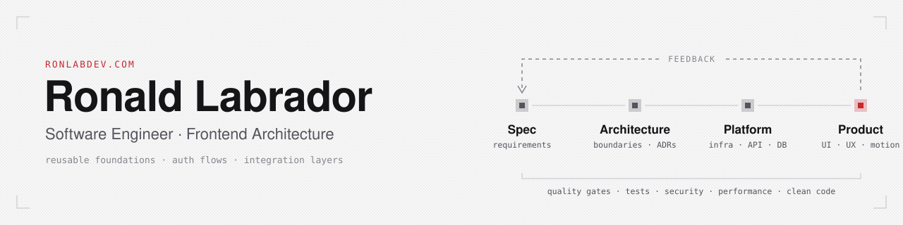

<picture>
  <source media="(prefers-color-scheme: dark)" srcset="assets/banner-dark.svg">
  
</picture>

  <a href="https://ronlabdev.com">Portfolio</a> &nbsp;·&nbsp;
  <a href="https://www.linkedin.com/in/ronlab89/">LinkedIn</a> &nbsp;·&nbsp;
  <a href="mailto:ronlabdev@gmail.com">Email</a>

## About

Software engineer focused on frontend architecture and scalable web applications. I design reusable foundations, authentication flows and integration layers, and I make technical decisions that keep systems maintainable as products and teams grow.

## How I work

|   Spec       |  Architecture     |  Platform        |  Product         |
| :----------: | :---------------: | :--------------: | :--------------: |
| requirements | boundaries · ADRs | infra · API · DB | UI · UX · motion |

Every stage feeds back into the one before it, behind quality gates: tests, security, performance and clean code. AI agents work inside that loop under written specifications, and I approve and verify every change.

## Featured project

**[Trading Analytics Platform](https://github.com/ronlab89/trading-analytics-platform)** · completed

Full-stack portfolio analytics for independent traders: a REST and WebSocket API, a web app, and a public demo that runs the same application layer inside the browser. A monorepo with 2 apps, 6 shared packages, 15 API routers, 16 data models and 12 architecture decision records.

`TypeScript` `React` `Vite` `TanStack Query` `Zustand` `Express` `Prisma` `PostgreSQL` `WebSocket`

[Live demo](https://trading.ronlabdev.com/) · [Source](https://github.com/ronlab89/trading-analytics-platform)

## Stack

| | |
| :-- | :-- |
| **Languages** | `TypeScript` `JavaScript` `HTML5` `CSS3` `PHP` |
| **Frontend** | `React` `Astro` `Vue` `Next.js` `Nuxt.js` |
| **Backend** | `Node.js` `Express.js` `Nest.js` `Laravel` |
| **Data** | `PostgreSQL` `MongoDB` `MySQL` `Supabase` `Firebase` |
| **UI and motion** | `Tailwind CSS` `shadcn/ui` `GSAP` `Lenis` `Framer Motion` |
| **Quality** | `Vitest` `Testing Library` `Playwright` `SonarQube` `Jenkins` |
| **Tooling** | `Git` `GitHub` `GitLab` `Docker` `Figma` `Jira` |

## Contact

Open to conversations about frontend architecture and product engineering. The fastest way to reach me is [ronlabdev@gmail.com](mailto:ronlabdev@gmail.com) or [LinkedIn](https://www.linkedin.com/in/ronlab89/).
